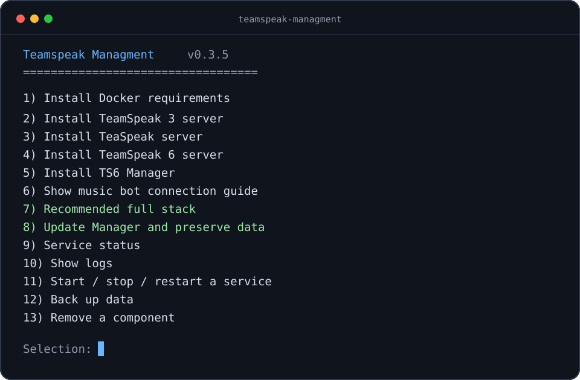

# Teamspeak Managment

English · [Türkçe](README.md)



An interactive Docker Compose deployment and management tool for TeamSpeak 3, TeaSpeak,
TeamSpeak 6, TS6 Manager, and the Manager music bot.

| Metadata | Value |
|---|---|
| Version | **0.3.6** |
| Developer | **Berat Akar** |
| Source | [GitHub @iNUIZ](https://github.com/iNUIZ) |

## Downloads

- [GitHub Releases](https://github.com/iNUIZ/teamspeak-managment/releases): a Windows ZIP, Linux/ARM TAR.GZ, and signed SHA-256 manifest
- [GitHub Packages](https://github.com/users/iNUIZ/packages?repo_name=teamspeak-managment): npm package

Releases provide `*-windows.zip` for Windows and `*-linux.tar.gz` for Ubuntu/
Debian x86_64 and ARM64. The Windows ZIP includes `install.ps1` plus the shared
`install.sh` and Docker definitions required inside WSL2. The Linux archive does
not include PowerShell or npm development files.

## Components

- TeamSpeak 3 Server with HTTP WebQuery
- TeaSpeak Server
- TeamSpeak 6 Server with WebQuery
- TS6 Manager web panel
- Manager music bot support
- Service control, logs, backup, and data-preserving updates

Every deployment starts with clean Docker volumes. The repository contains no
passwords, API keys, SSH keys, bot identities, databases, or existing server data.

TS3, TeaSpeak, and TS6 can coexist on one host with distinct ports. Selecting an
already installed component offers a second isolated instance under
`/opt/teamhub-2` and Compose project `teamhub2`; it has separate volumes/network
and ports are checked again. The existing instance can instead be recreated with
its data preserved. An accidental repeated selection does not erase data.

## Requirements

| Platform | Requirements |
|---|---|
| Ubuntu/Debian x86_64 | Root/sudo access and an internet connection |
| Ubuntu/Debian ARM64 | Root/sudo and internet; QEMU/binfmt is prepared for TS3; TeaSpeak is unsupported |
| Windows 10/11 | Docker Desktop, WSL2, Node.js 18+, and npm 9+ |

The Linux installer adds Docker's official APT repository when Docker is not
installed. Docker Desktop WSL Integration must be enabled on Windows.
Distribution security updates are applied to the TS3 and TS6 base images during
installation; CI scans the same hardened images for HIGH and CRITICAL CVEs.

## Installation

### Ubuntu or Debian

```bash
git clone https://github.com/iNUIZ/teamspeak-managment.git
cd teamspeak-managment
chmod +x install.sh
sudo ./install.sh
```

### ARM64 Linux

Use the same Linux commands. If a native Manager image is unavailable, the
installer builds an ARM64 image from a pinned upstream commit. The official TS3
image is amd64-only, so the TS3 option installs and verifies Docker binfmt/QEMU emulation.

### Windows 10/11 — PowerShell and npm

1. Install Docker Desktop and enable your distribution under
   **Settings > Resources > WSL Integration**.
2. Install Node.js LTS and npm.
3. Run these commands in the project directory from PowerShell:

```powershell
npm install
npm run setup
```

`npm run setup` starts the PowerShell launcher and executes the shared installer
engine through WSL2. Git Bash is not required.

One-line alternative that downloads the latest Release, verifies its Ed25519
signature, and only then verifies the archive SHA-256:

```powershell
irm https://raw.githubusercontent.com/iNUIZ/teamspeak-managment/v0.3.6/bootstrap.ps1 | iex
```

The command is pinned to the immutable `v0.3.6` release tag. Review
`bootstrap.ps1` before running it in a production environment.

### WSL2 terminal

```bash
chmod +x install.sh
sudo ./install.sh
```

## Network model

TeamSpeak, Manager, and the bot may share one public IP on the same VPS. Internal
traffic uses the private `teamhub` Docker network:

```text
Internet ── voice/file ports ──> TS3, TeaSpeak, or TS6
HTTPS/domain ── reverse proxy ──> Manager (default 127.0.0.1:3000)
Manager + bot ── private Docker network ──> ts3:10080 or ts6:10080
```

`0.0.0.0` is a bind value meaning all interfaces, not an address clients use.
Clients connect to the server's public IP or hostname. Query ports bind to
localhost by default. Manager setup offers either the secure default SSH tunnel
and prints an exact Windows PowerShell command, or direct network access. Direct
access should be protected with a TLS reverse proxy and firewall.

## Data locations

- Linux and WSL2: `/opt/teamhub`
- Second isolated instance: `/opt/teamhub-2`
- Windows launcher deployment data: `/opt/teamhub` inside WSL2
- Persistent volumes: `teamhub_ts3-data`, `teamhub_ts6-data`,
  `teamhub_teaspeak-*`, `teamhub_manager-data`, and `teamhub_manager-music`

The generated `.env` contains secrets and must never be committed.
The backup action records the services that are actually running, stops only
those services, and restarts only that same set. Persistent volumes, `.env`, and
`compose.yml` are streamed into an AES-256-CBC + PBKDF2 encrypted `.tar.gz.enc`
archive. The password is never stored and must contain at least 16 characters.

To decrypt and extract a backup:

```bash
openssl enc -d -aes-256-cbc -pbkdf2 -iter 600000 \
  -in teamhub-DATE.tar.gz.enc | tar xzf -
```

Manager runs without root as UID/GID `10001`. TS3, TS6, TeaSpeak, and Manager drop all
Linux capabilities and enable `no-new-privileges`; Manager also uses a read-only
root filesystem.

## Initial Manager connection

1. Create the first administrator at the `/setup` URL printed by the installer.
2. For an in-stack TS6 server, use host `ts6` and port `10080`.
3. For TS3, use host `ts3` and port `10080`.
4. Read the corresponding API key from `/opt/teamhub/.env`.

## License and dependencies

Installer code is released under the [MIT license](LICENSE). TeamSpeak software
and `uniskela/ts6-manager` remain subject to their own licenses and terms.
TeaSpeak is free to use; an optional license code is read without echo and stored
only in `/opt/teamhub/.env`. The installer verifies the pinned SHA-256 digest of
the TeaSpeak 1.5.6 archive before building its local image.
