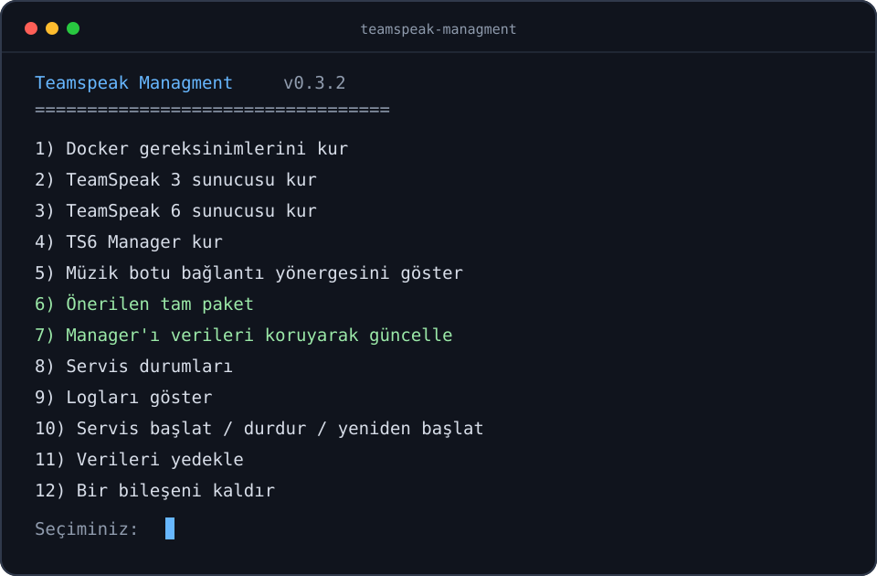

# Teamspeak Managment

[English](README.en.md) · Türkçe



TeamSpeak 3, TeamSpeak 6, TS6 Manager ve müzik botu bileşenlerini Docker
Compose ile kuran ve yöneten etkileşimli dağıtım aracı.

| Bilgi | Değer |
|---|---|
| Sürüm | **0.3.1** |
| Geliştirici | **Berat Akar** |
| Kaynak | [GitHub @iNUIZ](https://github.com/iNUIZ) |

## İndirmeler

- [GitHub Releases](https://github.com/iNUIZ/teamspeak-managment/releases): sürümlenmiş ZIP, TAR.GZ ve SHA-256 dosyaları
- [GitHub Packages](https://github.com/users/iNUIZ/packages?repo_name=teamspeak-managment): npm paketi

## Bileşenler

- TeamSpeak 3 Server ve HTTP WebQuery
- TeamSpeak 6 Server ve WebQuery
- TS6 Manager web paneli
- Manager müzik botu desteği
- Servis yönetimi, log görüntüleme, yedekleme ve güvenli güncelleme

Kurulumlar temiz Docker volume'larında oluşturulur. Repo; parola, API anahtarı,
SSH anahtarı, bot kimliği, veritabanı veya mevcut sunucu verisi içermez.

## Gereksinimler

| Platform | Gereksinimler |
|---|---|
| Ubuntu/Debian x86_64 | Root/sudo, internet bağlantısı |
| Ubuntu/Debian ARM64 | Root/sudo, internet bağlantısı; TS3 için amd64 emülasyonu |
| Windows 10/11 | Docker Desktop, WSL2, Node.js 18+ ve npm 9+ |

Linux kurucusu Docker bulunmadığında Docker'ın resmî APT deposunu kullanır.
Windows'ta Docker Desktop'ın WSL Integration özelliği etkin olmalıdır.

## Kurulum

### Ubuntu veya Debian

```bash
git clone https://github.com/iNUIZ/teamspeak-managment.git
cd teamspeak-managment
chmod +x install.sh
sudo ./install.sh
```

### ARM64 Linux

ARM64 kurulumu aynı komutları kullanır. Manager için uygun hazır imaj yoksa
kurucu sabitlenmiş kaynak commit'inden yerel ARM64 imajı üretir. Resmî TS3 imajı
amd64 olduğundan TS3 seçeneği Docker binfmt/QEMU emülasyonunu doğrular.

### Windows 10/11 — PowerShell ve npm

1. Docker Desktop'ı kurun ve **Settings > Resources > WSL Integration** altında
   kullandığınız WSL dağıtımını etkinleştirin.
2. Node.js LTS sürümünü ve npm'i kurun.
3. PowerShell'de proje klasöründe çalıştırın:

```powershell
npm install
npm run setup
```

`npm run setup`, PowerShell başlatıcısını çalıştırır ve kurulum motorunu WSL2
üzerinden açar. Git Bash gerekli değildir.

En son Release paketini indirip SHA-256 değerini doğrulayan tek satırlık alternatif:

```powershell
irm https://raw.githubusercontent.com/iNUIZ/teamspeak-managment/v0.3.1/bootstrap.ps1 | iex
```

Komut değiştirilemeyen `v0.3.1` sürüm etiketine sabitlenmiştir. Üretim ortamında
çalıştırmadan önce `bootstrap.ps1` içeriğinin incelenmesi yine de önerilir.

### WSL2 terminali

```bash
chmod +x install.sh
sudo ./install.sh
```

## Ağ modeli

TeamSpeak, Manager ve bot aynı VPS üzerinde tek public IP'yi paylaşabilir.
Bileşenler birbirlerine `teamhub` Docker ağı üzerinden bağlanır:

```text
İnternet ── ses/dosya portları ──> TS3 veya TS6
HTTPS/domain ── reverse proxy ──> Manager (varsayılan 127.0.0.1:3000)
Manager + bot ── özel Docker ağı ──> ts3:10080 veya ts6:10080
```

Query ve Manager portları varsayılan olarak localhost'a bağlanır. Uzak panel
erişimi için TLS kullanan reverse proxy ve güvenlik duvarı önerilir.

## Veri konumları

- Linux ve WSL2: `/opt/teamhub`
- Windows başlatıcı yapılandırması: WSL2 içindeki `/opt/teamhub`
- Kalıcı veriler: `teamhub_ts3-data`, `teamhub_ts6-data`,
  `teamhub_manager-data`, `teamhub_manager-music`

Üretilen `.env` dosyası gizli anahtarları içerir ve repoya eklenmemelidir.

## İlk Manager bağlantısı

1. Kurucunun gösterdiği `/setup` adresinde ilk yönetici hesabını oluşturun.
2. Aynı Compose paketi içindeki TS6 için host `ts6`, port `10080` kullanın.
3. TS3 için host `ts3`, port `10080` kullanın.
4. İlgili API anahtarını `/opt/teamhub/.env` dosyasından alın.

## Lisans ve bağımlılıklar

Kurucu kodu [MIT lisansı](LICENSE) ile yayımlanır. TeamSpeak yazılımları ve
`uniskela/ts6-manager` kendi lisansları ve kullanım koşullarına tabidir.
